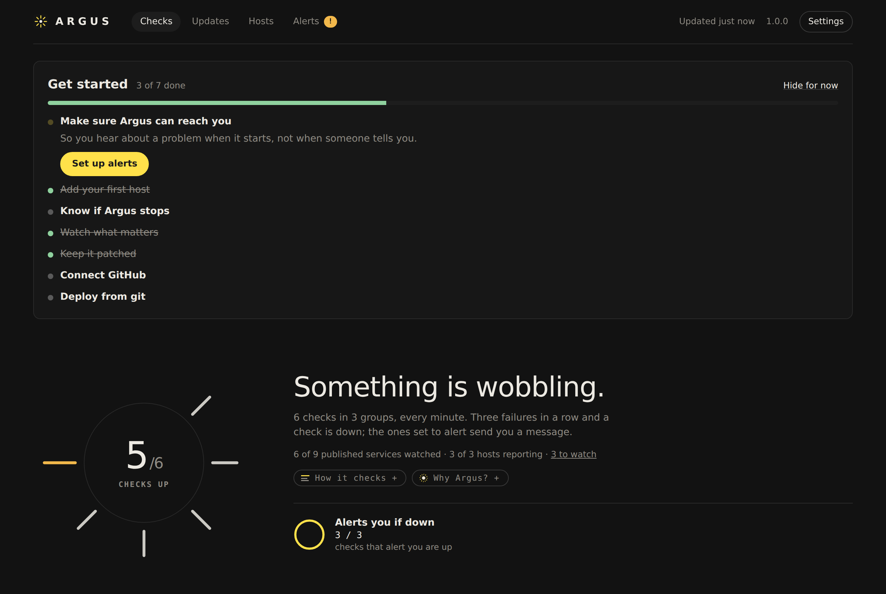
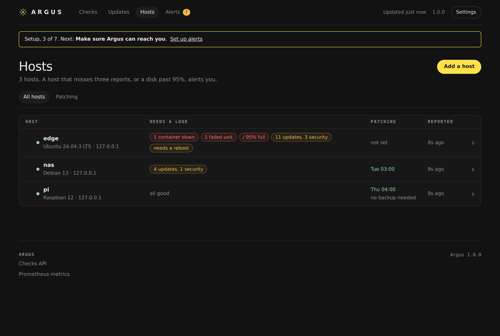

# Argus

**Keep a homelab watched, patched and deployed, from one container.**

Argus checks your services and pages you when one stops answering. A small companion on each host shows its containers, disks and pending updates, patches it in a weekly window once it has a recent backup, and deploys your Compose stacks from git when you merge. No Prometheus, Grafana or Alertmanager needed, and no config files unless you want them.



## What it does

- **Watches** anything with a URL, a port or an address, every minute; three failures in a row and it pages you on Telegram (or hands off to your Prometheus). Pause one you already know is down.
- **Knows your hosts.** One command adds a host; Argus then shows its containers, disks, failed services and pending updates, and suggests a check for every port its containers publish.
- **Patches** each host on the weekly schedule you choose, one host at a time, once it has a backup Argus can see. You decide how recent that backup must be, how far updates go, and whether it may reboot. Already patching a host another way? Tell Argus and it leaves that host alone.
- **Deploys from git.** Keep each host's Compose stacks in a repo; a merge deploys them, a stack that does not come up healthy is rolled back, and stacks already running can be adopted in place with one button.
- **Follows your apps' updates** on GitHub: Dependabot's PRs, CI, merges and builds, to "running on its host".
- **Guides you in.** A new install opens on a short checklist that takes you from nothing to your first host watched, patched and deploying.



## Quick start

```yaml
# compose.yml
services:
  argus:
    image: ghcr.io/devinmb/argus:1
    ports: ["8443:8080"]
    volumes: [argus-data:/data]
    cap_add: [NET_RAW]   # for ping checks
    restart: unless-stopped
volumes:
  argus-data:
```

```bash
docker compose up -d
docker compose logs argus | grep "Setup code"
```

Open **https://your-host:8443**. Argus makes its own certificate, so the browser warns once. Enter the setup code and choose a password, then follow the checklist. Want to look around first? [`scripts/demo.py`](scripts/demo.py) fills a fresh install with a made-up homelab.

## Learn more

- [Install](docs/install.md): requirements, the first sign-in, HTTPS and proxies, upgrading, removing a companion.
- [Guide](docs/guide.md): checks, hosts, patching and backups, deploys and adopting stacks, GitHub, backing up Argus.
- [Config](docs/config.md): every field of `argus.yml`, for people who prefer files.
- [Security](docs/security.md): what Argus holds, how it is protected, and what a companion can and cannot do.
- [Design](docs/design.md) and [developing Argus](docs/develop.md).

## License

Apache-2.0. See [LICENSE](LICENSE).
